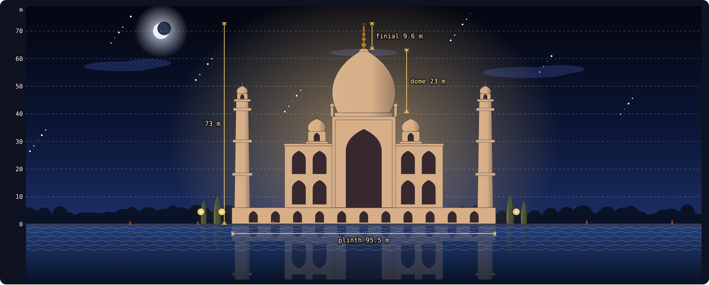
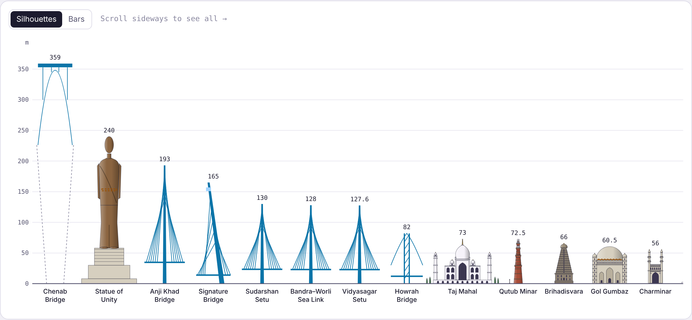
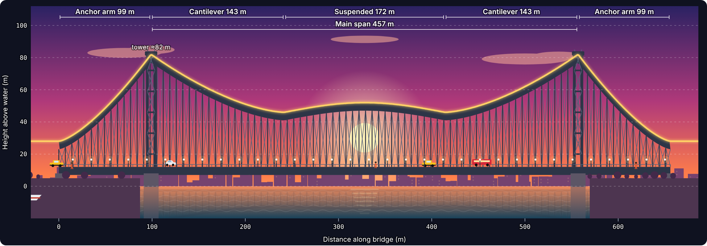
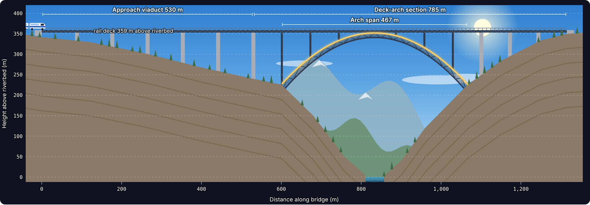

# Bharat in Elevation

An interactive atlas of India's famous bridges and monuments, each one drawn as a chart from its published dimensions. Bridges are plotted as height-over-distance profiles in animated river and sea scenes. Monuments are drawn as true-scale front elevations in their surroundings. The whole site is a single HTML file and uses no images: every scene, building, vehicle and person is drawn with SVG, HTML and CSS.

**Live site: <https://kuntal-hub.github.io/Bharat_in_Elevation/>**

## Quick start

Open the [live site](https://kuntal-hub.github.io/Bharat_in_Elevation/), or run it locally:

1. Download `index.html`.
2. Open it in any modern browser (Chrome, Edge, Firefox or Safari).

You don't need to install anything or run a build step. The site is published with GitHub Pages from the root of the `main` branch. To host it anywhere else, upload `index.html` to any static host.

## What's inside

**34 structures: 15 bridges and 19 monuments.**

### Bridges

| Bridge | Place | Type | Opened | Headline figure |
|---|---|---|---|---|
| Howrah Bridge | Kolkata, West Bengal | Cantilever truss | 1943 | 457 m main span |
| Vidyasagar Setu | Kolkata, West Bengal | Cable-stayed | 1992 | 457.2 m main span, 127.6 m pylons |
| Bandra–Worli Sea Link | Mumbai, Maharashtra | Cable-stayed + viaduct | 2009 | 5.6 km, 128 m tower |
| Atal Setu (MTHL) | Mumbai – Navi Mumbai | Sea viaduct | 2024 | 21.8 km, India's longest sea bridge |
| Chenab Rail Bridge | Reasi, Jammu & Kashmir | Steel arch (rail) | 2025 | Deck 359 m above the riverbed |
| Anji Khad Bridge | Reasi, Jammu & Kashmir | Cable-stayed (rail) | 2025 | 193 m pylon, 290 m main span |
| Bhupen Hazarika Setu | Tinsukia, Assam | Concrete beam | 2017 | 9.15 km, 183 spans |
| Bogibeel Bridge | Dibrugarh, Assam | Road-and-rail steel truss | 2018 | 4.94 km |
| Mahatma Gandhi Setu | Patna – Hajipur, Bihar | Steel truss on concrete piers | 1982 | 5.75 km |
| Godavari Arch Bridge | Rajahmundry, Andhra Pradesh | Bowstring arch (rail) | 1997 | 28 arches × 97.55 m |
| New Pamban Bridge | Rameswaram, Tamil Nadu | Vertical-lift rail bridge | 2025 | 72.5 m lift span |
| Signature Bridge | Wazirabad, Delhi | Asymmetric cable-stayed | 2018 | 165 m pylon |
| Sudarshan Setu | Dwarka, Gujarat | Cable-stayed | 2024 | 500 m main span, India's longest |
| Lakshman Jhula | Rishikesh, Uttarakhand | Suspension footbridge | 1930 | ≈137 m span |
| Coronation Bridge | Sevoke, West Bengal | Concrete arch | 1941 | 81.7 m arch |

### Monuments

| Monument | Place | Built | Height |
|---|---|---|---|
| Taj Mahal | Agra | 1632–1653 | 73 m |
| Qutub Minar | Delhi | c. 1199–1220 | 72.5 m |
| Statue of Unity | Kevadia, Gujarat | 2018 | 182 m (240 m with base) |
| Brihadisvara Temple | Thanjavur | 1003–1010 CE | ≈66 m |
| Meenakshi Temple, south gopuram | Madurai | Late 16th c. | 52 m |
| Konark Sun Temple | Konark, Odisha | c. 1250 CE | ≈39 m hall (≈70 m tower, lost) |
| Gol Gumbaz | Vijayapura, Karnataka | 1656 | 60.5 m |
| Charminar | Hyderabad | 1591 | ≈56 m |
| Humayun's Tomb | Delhi | 1565–1572 | 47 m |
| India Gate | New Delhi | 1921–1931 | 42 m |
| Gateway of India | Mumbai | 1924 | 26 m |
| Buland Darwaza | Fatehpur Sikri | Begun 1573 | ≈54 m from ground |
| Mahabodhi Temple | Bodh Gaya, Bihar | 5th–6th c. CE | ≈55 m |
| Hawa Mahal | Jaipur | 1799 | ≈15 m |
| Great Stupa, Sanchi | Sanchi, Madhya Pradesh | 3rd c. BCE | 16.46 m, 36.6 m across |
| Kandariya Mahadeva Temple | Khajuraho | c. 1025–1050 | 31 m |
| Victoria Memorial | Kolkata | 1906–1921 | 56 m |
| Samrat Yantra, Jantar Mantar | Jaipur | 1728–1734 | 27 m |
| Lotus Temple | New Delhi | 1986 | 40.8 m |

## Features

### Comparison plates

- **Atlas.** A drawn map of India with a pin for each structure. Tap a pin or a name to jump to that structure's chart.
- **Heights.** Every structure side by side at one scale, shown as silhouettes or as bars.
- **Spans.** Bridges ranked by longest single span or by total length, with an optional log scale.
- **Timeline.** About 2,275 years of building, from Ashoka's stupa to the Chenab arch. On phones it switches to a vertical list.

### Bridge charts

- The yellow profile line traces height above water (or above the riverbed) along the bridge. Hover or tap anywhere to read distance, height and section.
- Brackets mark each section's length: anchor arms, main spans, side spans, steel spans and so on.
- Cars, buses, autos, trains, pedestrians, boats and birds move through each scene.
- For long bridges (Atal Setu, Bhupen Hazarika Setu, Bandra–Worli and others), drag the strip under the scene to travel along the full length.
- On New Pamban Bridge, a button raises the lift span so a ship can pass.

### Monument charts

- Each front elevation is drawn to true scale. A white 1.7 m figure stands in front for reference, and visitors walk past at real size and walking speed.
- Hover a part of a building to name it and highlight it. A dashed line reads the height at the cursor.
- Each monument has its own setting: reflecting pools at the Taj Mahal, Victoria Memorial and Lotus Temple; the sea at the Gateway of India; traffic at Charminar and Hawa Mahal; the Bodhi tree at Mahabodhi.
- Four monuments have an extra interactive:
  - **Konark:** the carved wheel works as a sundial you can drag.
  - **Jantar Mantar:** a quadrant dial shows where the shadow falls, including for the current time.
  - **Lotus Temple:** a plan view highlights the three rings of nine petals.
  - **Gol Gumbaz:** a button "claps" in the whispering gallery.
- On the Great Stupa at Sanchi, you can show the original Ashokan stupa hidden inside the present dome.

### Controls

| Control | Where | What it does |
|---|---|---|
| Day / Sunset / Night | Top bar and every chart | Relights every scene. At night the stars come out, monuments are floodlit, and lamps and windows glow. |
| Structure picker | Top bar | Shows a single structure on its own. "Show all structures" brings the rest back. |
| All / Bridges / Monuments | Top bar | Filters the map, charts and comparison plates. |
| Full screen | Every chart | Enlarges that chart to fill the screen. Press it again or Esc to exit. |
| Legend buttons | Every chart | Turn layers such as the profile line, dimensions, traffic, height grid and person on or off. |

The page follows your device's light or dark mode. Every chart redraws to fit when the window is resized, from phone width up to wide screens.

## Technical notes

- **One file, about 235 KB.** All styles and scripts are inline, and no JavaScript libraries are used: everything is plain SVG, HTML, CSS and JavaScript.
- **Fonts.** The page loads Rozha One, Hind and IBM Plex Mono from Google Fonts. Offline, it falls back to system fonts and still works fully.
- **Animation.** Vehicles move with SVG `animateMotion`; sky, water and clouds use CSS animations. Charts pause their animation when scrolled off screen, and motion is reduced when the system's "reduce motion" setting is on.
- **Full screen.** Uses the browser's Fullscreen API. Where the browser doesn't allow it, the chart expands to fill the window instead.
- **Deep links.** Open the file with a structure's ID after `#` to jump straight to it, for example [`#taj`](https://kuntal-hub.github.io/Bharat_in_Elevation/#taj) or [`#chenab`](https://kuntal-hub.github.io/Bharat_in_Elevation/#chenab).

## Data and accuracy

Spans, heights, lengths and dates come from published figures, mainly the Wikipedia article for each structure, checked in October 2026.

- Profiles and elevations are simplified. Truss panels, cable counts, pier spacing and decorative detail are schematic.
- Figures marked ≈ are indicative because no official value is published. Examples are several deck clearances and a few base widths, such as the Meenakshi gopuram and Buland Darwaza.
- Some sources disagree (for example Charminar at 56 m or 48.7 m). Where that happens, the chart's note says which figure is used.
- Vertical scales on bridge charts are often exaggerated so long, low bridges stay readable. Each chart states its exaggeration below the scene.
- The map is a simplified outline for orientation. It is not to scale and is not an authoritative boundary.

## Adding a structure

Inside the `<script>` block, each structure is one object in the `BRIDGES` or `MONUMENTS` list. It contains:

- name, place and year
- coordinates for the map pin
- a stats list for the chart's figure boxes
- a `draw` function that builds the drawing in real metres
- for monuments, a `scene` setting for the ground, backdrop, visitors and traffic

The easiest way to add one is to copy a similar entry, change the numbers and add the new object to the list. The map, comparison plates, timeline and picker update automatically.
